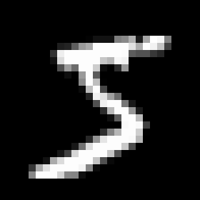
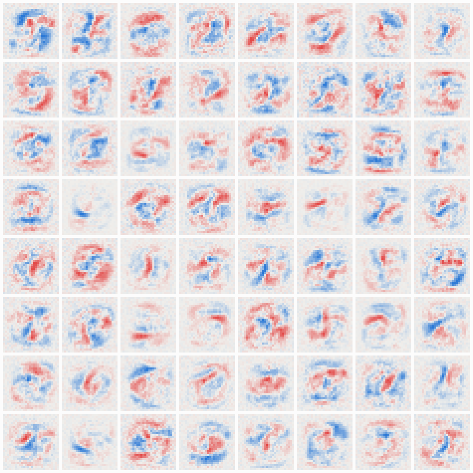

# MNIST from Scratch in C++

A handwritten-digit classifier written from scratch in C++. It uses no ML libraries, no linear algebra libraries, and no frameworks: just the standard library, a single `main.cpp`, and the math worked out by hand.

It reads the raw MNIST files, trains a 784 → 64 → 10 neural network with mini-batch gradient descent and backpropagation, and classifies the 10,000 held-out test digits with **~97% accuracy**.

<p align="center">
  
</p>

## Results

| Setting | Value |
|---|---|
| Architecture | 784 inputs → 64 sigmoid hidden neurons → 10 softmax outputs |
| Parameters | 50,890 |
| Training | 60,000 images, mini-batches of 32, shuffled each epoch |
| Loss | Cross-entropy |
| **Test accuracy** | **96.75%** (15 epochs, learning rate 0.1) |
| Training time | about 6 s per epoch on one CPU core (Release build) |

The backpropagation was verified with a numerical gradient check: analytic and finite-difference gradients agree to 8–10 significant digits for every parameter type.

## How it works

1. **Load the data:** MNIST ships in the IDX binary format, with a big-endian header (magic number, count, rows, cols) followed by raw bytes. `readBigEndian32` assembles each header field from 4 bytes with shifts and ORs. The pixels are read in one bulk `read` and scaled to 0–1.
2. **Forward pass:** each hidden neuron takes a weighted sum of all 784 pixels plus a bias and applies sigmoid. Each output neuron takes a weighted sum of the 64 hidden activations. Softmax turns the 10 output scores into probabilities, subtracting the max score first so `exp` can't overflow.
3. **Loss:** cross-entropy, `-log(p[label])`. An untrained network scores about ln(10) ≈ 2.30.
4. **Backprop:** with softmax plus cross-entropy, the output error is simply `p − one_hot(label)`. Hidden errors are `(Σ output_error × weight) × h(1 − h)`. Each weight's gradient is error × the input it multiplied.
5. **Training:** shuffle an index list each epoch, walk through it in batches of 32, average the gradients over the batch, and step `w -= lr × grad`.
6. **Evaluation:** the prediction is the argmax of the 10 probabilities, scored against the 10,000 test images the network never trained on.

### Code tour (`main.cpp`)

| Function | Job |
|---|---|
| `readBigEndian32` | Read one 4-byte big-endian integer from the file |
| `loadImages` / `loadLabels` | Parse the IDX files, validate magic numbers and sizes |
| `printDigit` | ASCII-art preview of any image |
| `initModel` | Random weights in ±1/√(inputs), biases at 0 |
| `forward` | Hidden sigmoid layer, then output scores, then `softmax` |
| `totalLoss` | Average cross-entropy over a range of images |
| `computeGradient` | Backprop over one mini-batch (follows the shuffled order) |
| `updateModel` | Gradient descent step |
| `train` | Epoch and batch loop with shuffling |
| `accuracy` | Test-set accuracy via argmax |

## What the network learned

Each tile below is one hidden neuron's 784 weights drawn as a 28×28 image. Blue means "ink here turns this neuron on," and red means "ink here turns it off." The neurons learned blurry stroke and curve detectors, not whole digits. The output layer combines them into a vote for each digit.

<p align="center">
  
</p>

The most common mistakes on the test set are **4 → 9**, **7 → 2**, **5 → 3** and **9 → 4**: pairs that differ by one stroke.

### Interactive tools

I built two companion web pages:

- **Network explorer:** follow a test digit through the network, inspect each neuron's weights and votes, and view training curves and the confusion matrix.
- **Draw a digit:** draw your own digit, convert it to a 28×28 MNIST-style image (crop, scale to 20×20, center by center of mass), and see what the network predicts.

<p align="center">
  
  
</p>

## Experiments

**How many hidden neurons?** Same setup, 15 epochs, learning rate 0.5:

| Hidden | 0 | 2 | 4 | 8 | 16 | 32 | 64 | 128 |
|---|---|---|---|---|---|---|---|---|
| Test % | 91.7 | 42.8 | 82.9 | 91.4 | 94.6 | 97.0 | 97.6 | 98.1 |

Two neurons is worse than no hidden layer at all, because squeezing everything through two numbers throws information away. Beyond about 64 neurons, doubling the size buys only about 0.5%.

**Does a second hidden layer help?** Barely. 64→32 scored 97.68% against 97.61% for 64 alone, and widening to 128 neurons (98.13%) beat every two-layer version tried. Deeper sigmoid networks train more slowly because of vanishing gradients.

**Does position matter?** A lot. Shifting the test digits sideways drops accuracy fast, because every weight is tied to one fixed pixel:

| Shift right | 0 px | 1 px | 2 px | 3 px | 4 px | 6 px |
|---|---|---|---|---|---|---|
| Test % | 96.6 | 93.7 | 75.5 | 52.3 | 30.3 | 9.2 |

That's why the draw-a-digit page centers drawings the same way MNIST does, and why convolutional networks exist.

## Running it

1. **Get the data:** download the four files from the [MNIST mirror](https://storage.googleapis.com/cvdf-datasets/mnist/) and unzip them next to `main.cpp`:
   ```
   train-images-idx3-ubyte   (47,040,016 bytes)
   train-labels-idx1-ubyte   (60,008 bytes)
   t10k-images-idx3-ubyte    (7,840,016 bytes)
   t10k-labels-idx1-ubyte    (10,008 bytes)
   ```
   Direct links: [train images](https://storage.googleapis.com/cvdf-datasets/mnist/train-images-idx3-ubyte.gz), [train labels](https://storage.googleapis.com/cvdf-datasets/mnist/train-labels-idx1-ubyte.gz), [test images](https://storage.googleapis.com/cvdf-datasets/mnist/t10k-images-idx3-ubyte.gz), [test labels](https://storage.googleapis.com/cvdf-datasets/mnist/t10k-labels-idx1-ubyte.gz).
2. **Build:** open `MNIST.vcxproj` in Visual Studio and build in **Release x64**. Debug is 10–50× slower. Any C++17 compiler also works:
   ```
   g++ -O2 -std=c++17 main.cpp -o mnist
   ```
3. **Run:** it loads the data, trains, and prints the test accuracy. Change `HIDDEN`, `BATCH`, the epoch count or the learning rate at the top of the file or in `main`.

## Project history

This is the capstone of a series of from-scratch C++ ML projects: linear regression, then a perceptron, then logistic regression, then a 2-2-1 neural network learning XOR, and now this. The code here was written by hand, step by step, with an AI assistant acting as a tutor (hints and code review, no generated solutions).

## Ideas for next steps

- ReLU instead of sigmoid
- A validation split carved out of the training set
- Random ±2 px shifts during training (data augmentation)
- Export weights to `float` arrays and run inference on an ESP32
- A convolutional layer
